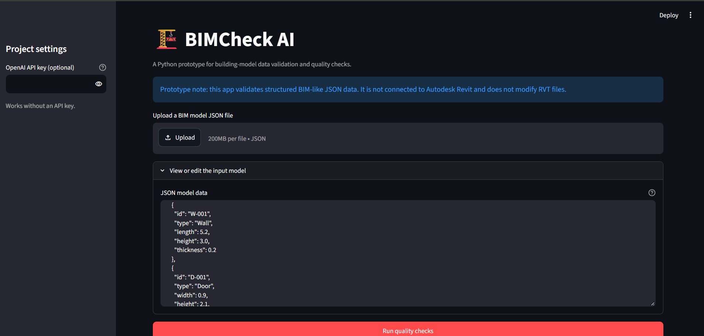
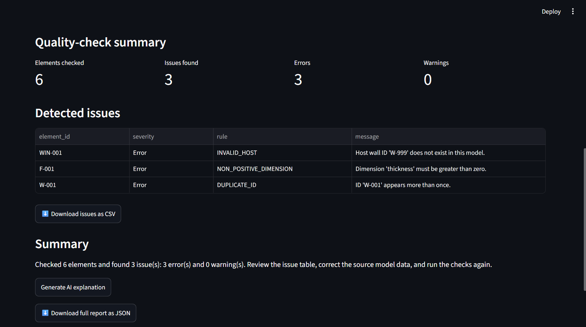
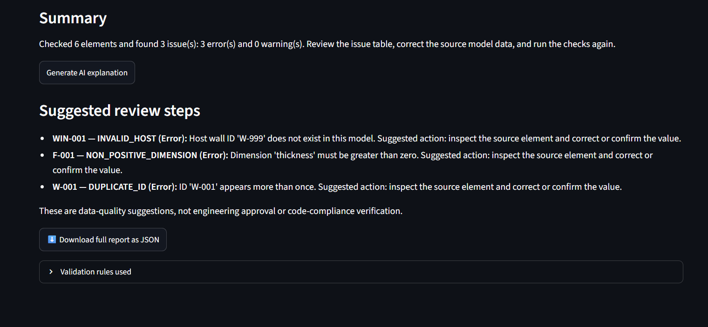

# 🏗️ BIMCheck AI — Building Model Quality Assistant

A Python-based prototype that validates structured building-model data, detects potential data-quality issues, and generates reports through an interactive dashboard.

> **Project status:** Prototype. This version validates JSON data and does not directly read or modify Autodesk Revit (`.rvt`) files.

## Table of Contents

- [About the Project](#-about-the-project)
- [Problem Statement](#-problem-statement)
- [Features](#-features)
- [Tech Stack](#-tech-stack)
- [Project Structure](#-project-structure)
- [Requirements](#-requirements)
- [Installation and Setup](#-installation-and-setup)
- [How to Run](#-how-to-run)
- [Input Data Format](#-input-data-format)
- [Validation Rules](#-validation-rules)
- [How It Works](#-how-it-works)
- [AI Integration](#-ai-integration)
- [Future Scope](#-future-scope)
- [Author](#-author)

## About the Project

Building Information Modeling (BIM) involves digital representations of building elements such as walls, doors, windows, floors, and columns. Missing dimensions, duplicate identifiers, and incorrect element references can make model reviews more difficult.

BIMCheck AI demonstrates how Python automation can validate structured building-element data, identify potential problems, and display the results in a web-based dashboard.

The project explores Python scripting, data validation, API integration, and BIM-related quality-check workflows.

## Problem Statement

Manually checking every building element for incomplete or inconsistent data can be time-consuming.

BIMCheck AI automates basic checks by:

1. Loading building-element data from a JSON file.
2. Applying predefined validation rules.
3. Identifying errors and warnings.
4. Displaying findings in an interactive dashboard.
5. Exporting results for further review.

## Features

-  **JSON input:** Use sample building data or upload a JSON file.
-  **ID validation:** Detect missing and duplicate element identifiers.
-  **Dimension validation:** Identify missing, non-numeric, zero, or negative dimensions.
-  **Element-type validation:** Check supported element types.
-  **Reference validation:** Check whether referenced host-wall IDs exist.
-  **Interactive dashboard:** Display element counts, errors, warnings, and issue details.
-  **Report export:** Download CSV issue reports and JSON summaries.
-  **Optional AI explanations:** Explain detected issues in plain English using the OpenAI API.
-  **Local fallback:** Generate basic explanations without an API key.

## Tech Stack

| Technology | Purpose |
|---|---|
| Python | Validation logic and application functionality |
| Streamlit | Interactive web interface |
| JSON | Structured building-element input |
| Pandas | Displaying issue tables and exporting CSV |
| OpenAI API (optional) | Natural-language explanations |
| Git and GitHub | Version control and project hosting |

## Project Structure

```text
bimcheck_ai/
├── app.py
├── bim_checker.py
├── requirements.txt
├── README.md
├── .gitignore
└── sample_data/
    └── sample_model.json
```

- `app.py` — Creates the dashboard, handles input, and displays results.
- `bim_checker.py` — Contains validation rules, summary generation, and issue explanations.
- `sample_data/sample_model.json` — Provides sample building-element data.
- `requirements.txt` — Lists Python dependencies.
- `.gitignore` — Excludes files such as virtual environments and secrets.
- `README.md` — Documents the project and setup instructions.

## Requirements

Install the following before running the application:

- Python 3.10 or newer
- pip
- VS Code or another Python editor
- Git (optional)
- Internet access for installing dependencies
- OpenAI API key only if using AI-generated explanations

**Autodesk Revit is not required for this prototype.**

## 🚀 Installation and Setup

### 1. Clone the repository

After creating your GitHub repository, run:

```bash
git clone https://github.com/Mayur-Nagpure/bimcheck-ai.git
cd bimcheck_ai
```

Alternatively, download and extract the project ZIP.

### 2. Create a virtual environment

```bash
python -m venv .venv
```

### 3. Activate the environment

**Windows Command Prompt:**

```bat
.venv\Scripts\activate.bat
```

**Windows PowerShell:**

```powershell
.\.venv\Scripts\Activate.ps1
```

**macOS/Linux:**

```bash
source .venv/bin/activate
```

### 4. Install dependencies

```bash
python -m pip install --upgrade pip
python -m pip install -r requirements.txt
```

## ▶️ How to Run

From the project root, execute:

```bash
python -m streamlit run app.py
```

Open the local URL displayed in your terminal, usually:

```text
http://localhost:8501
```

### Using the application

1. Open the dashboard.
2. Use the sample model or upload a JSON file.
3. Review or edit the input data.
4. Click **Run quality checks**.
5. Review the summary and detected issues.
6. Download the CSV issue report or JSON report.
7. Optionally click **Generate AI explanation**.

Press `Ctrl + C` in the terminal to stop the application.

## Input Data Format

The input JSON must contain an `elements` array.

Example:

```json
{
  "project_name": "Demo Office Building",
  "units": "meters",
  "elements": [
    {
      "id": "W-001",
      "type": "Wall",
      "length": 5.2,
      "height": 3.0,
      "thickness": 0.2
    },
    {
      "id": "D-001",
      "type": "Door",
      "width": 0.9,
      "height": 2.1,
      "host_wall_id": "W-001"
    }
  ]
}
```

### Supported element types

- `Wall`
- `Door`
- `Window`
- `Floor`
- `Column`
- `Beam`
- `Room`

The example uses metres. Dimensions should be supplied as numeric values in metres; automatic unit conversion is not implemented.

## Validation Rules

| Validation | Description |
|---|---|
| Missing ID | Flags elements without an identifier |
| Duplicate ID | Flags repeated identifiers |
| Missing or unsupported type | Checks whether an element type is provided and supported |
| Missing dimensions | Detects absent required dimensions |
| Non-numeric dimensions | Detects dimension values that cannot be converted to numbers |
| Non-positive dimensions | Flags zero or negative dimensions |
| Unusual dimensions | Warns when a dimension exceeds 100 metres |
| Missing host reference | Flags doors or windows without a host-wall reference |
| Invalid host reference | Flags references to IDs absent from the input model |

These are prototype validation rules, not official engineering standards. The current host-reference check verifies that an ID exists; it does not yet confirm that the referenced element is specifically a wall.

## How It Works

```text
JSON Input
    |
    v
Streamlit Interface (app.py)
    |
    v
Validation Engine (bim_checker.py)
    |
    v
Errors, Warnings and Summary
    |
    v
Dashboard and Issue Table
    |
    v
CSV / JSON Report Export
```

1. **Input:** JSON text is parsed into Python dictionaries and lists.
2. **Validation:** `check_model()` applies the rules to each element.
3. **Summary:** `build_summary()` calculates element and issue counts.
4. **Presentation:** Streamlit displays the results.
5. **Export:** Users can download CSV and JSON reports.
6. **Explanation:** The optional explanation function uses the OpenAI API when configured or built-in Python explanations otherwise.

## AI Integration

The project includes an optional OpenAI API integration that explains detected validation issues in natural language.

The validation engine itself is **rule-based**. AI is used to explain the findings, not to determine whether a building is structurally safe or compliant with building codes.

To use the feature:

1. Obtain an API key through your OpenAI account.
2. Run the application.
3. Enter the key in the optional API-key field in the sidebar.
4. Run the quality checks.
5. Click **Generate AI explanation**.

### Security considerations

- Never commit API keys to GitHub.
- Do not hard-code secrets in source files.
- API usage may incur charges.
- For a deployed application, use secure secrets management and appropriate access controls.

The application can run without an API key.

## 🔮 Future Scope

1. **Autodesk Revit API:** Extract element parameters from actual Revit models.
2. **Dynamo integration:** Automate model-data extraction and validation workflows.
3. **C# Revit plugin:** Build a native add-in using the Revit API.
4. **MCP integration:** Allow compatible AI assistants to invoke approved BIM-checking tools through the Model Context Protocol.
5. **Advanced validation:** Check element categories, parameter consistency, host relationships, and project-specific rules.
6. **Point-cloud workflows:** Explore comparisons between point-cloud-derived information and BIM elements.
7. **Enhanced reporting:** Add issue filters, severity levels, charts, and project-level reports.
8. **Automated testing:** Add unit tests with `pytest`.
9. **Secure deployment:** Add authentication, logging, and production-ready secret management.

## Project Screenshots





## Author

**Mayur Nagpure**  
Computer Science and Engineering  
Nagpur, Maharashtra, India

- GitHub: [GITHUB_PROFILE](https://github.com/Mayur-Nagpure)